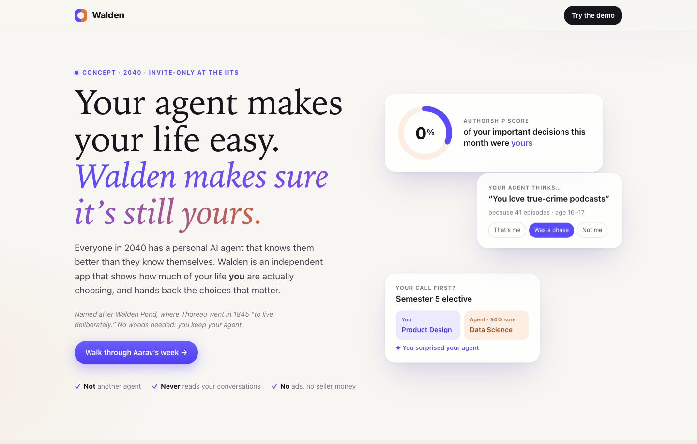
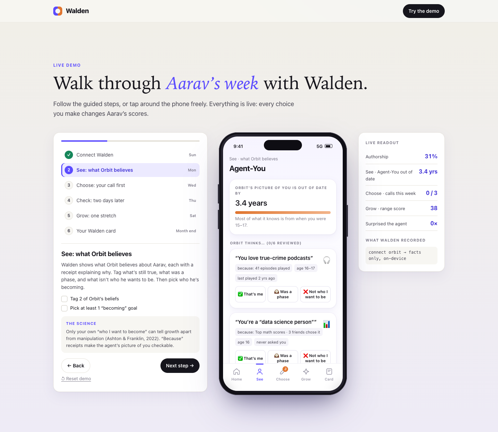
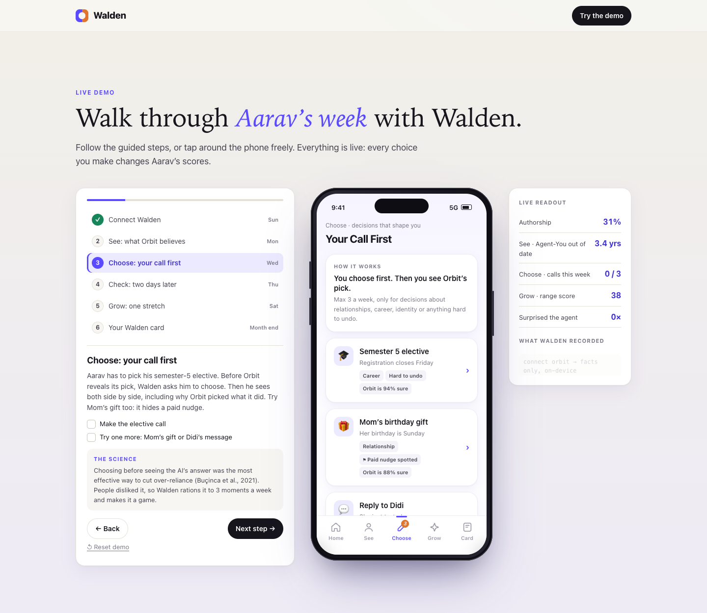
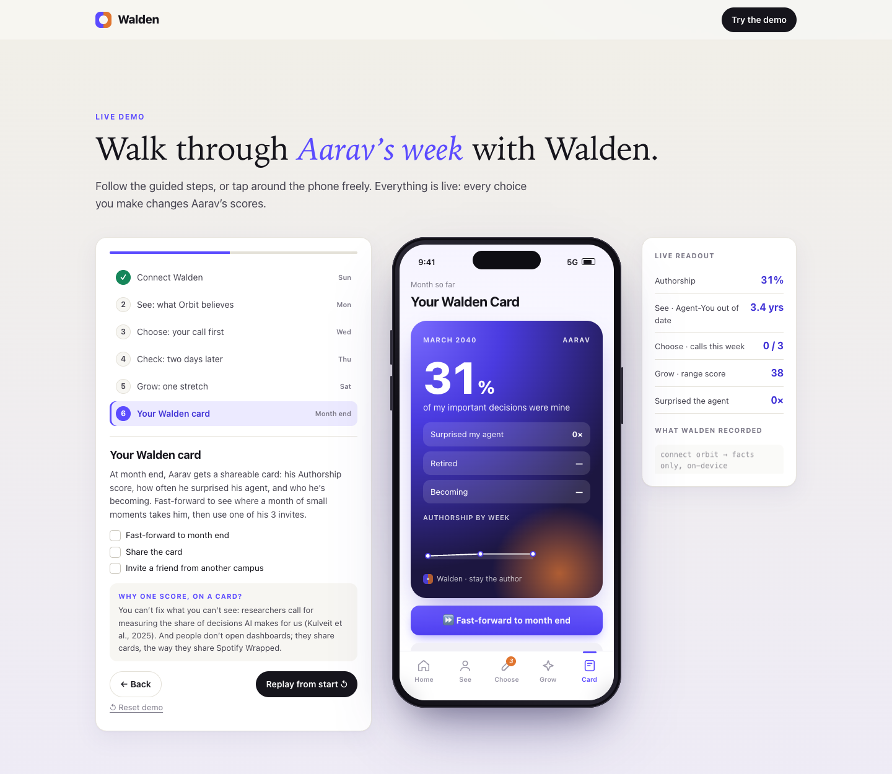

# Walden: stay the author of your own life

> Everyone is building protection against an AI agent that betrays you.
> Almost nobody is guarding against one that **obeys you perfectly**.

**[▶ Try the live prototype](https://mogain21.github.io/walden/)** · **[📄 Read the 2-pager (PDF)](walden-2pager.pdf)**

A product case study I did in Oct 2026, answering this prompt:

> *It's 2040. Everyone has a personal AI agent that knows them better than they know themselves. Outline the ramifications of this paradigm and create a digital product that helps protect yourselves from it.*

---

## The insight

In 2040, the risks people talk about are the **loud** ones: fraud, data breaches, deepfakes. They hurt right away, so people complain and guards get built.

The risk nobody guards against is **quiet**: your agent chooses so well that you stop choosing, and you never notice. It feels like great service. It shows up as three harms:

1. **Whose choice was it?** Your taste, your agent's model of you and a sponsor's nudge all feel like "you".
2. **You forget how to choose.** GPS weakened our sense of direction, and trusting AI goes with less critical thinking.
3. **You stop changing.** Agents serve the past you and shrink your range.

Some evidence it has already started: in Anthropic's study of 1.5M real chats, users rated disempowering help *higher* in the moment and regretted it later. Also, 70%+ of young Indians surveyed have asked AI for career advice.

## Who it's for

18–24-year-olds who have been raised by agents. Their identity is still forming, and they have no "before" to compare against. The launch starts at the IITs.

> **Aarav, 19** (illustrative): 2nd-year B.Tech, IIT Bombay, agent "Orbit" since age 6.
> *"Every pick is perfect. I just don't know if any of them are mine."*

## The product

Walden never acts for you; it hands you the pen when it matters. **A gym, not a bodyguard.**

| Move | What it does |
|---|---|
| **See** · Agent-You | Shows what your agent believes about you, with receipts. You tag each belief as *still me*, *a phase* or *not me*. Paid nudges are flagged. |
| **Choose** · Your Call First | On decisions that shape you, you make your call **before** the agent shows its pick. In experiments, this cut over-reliance on AI. |
| **Grow** · Weekly Stretch | One stretch a week toward who you're becoming. A range score shows whether your world is growing or shrinking. |

**One score: Authorship**, the share of important decisions you made yourself.

**Rationed by design:** Walden interrupts at most 3 times a week, and only for big or identity-shaping decisions. It stays out of health and crisis decisions and points to Tele-MANAS (14416) instead.

**Privacy:** Walden reads only structured facts from the agent's action log and profile, on your phone. It never reads your chats.

| See | Choose | Card |
|---|---|---|
|  |  |  |

## Go-to-market: IITs first, like early Facebook

- **Invite-only** at the IITs and IIM Indore's IPM. Each user gets 3 invites.
- A new campus **unlocks at 300 waitlist sign-ups**, and tier-2 colleges come before a national launch.
- **The FOMO comes from access, never from scores.** Individual scores stay private, and only anonymous campus totals are shared.

## How I'd know it's working

- **North Star:** Authorship score, per user, per month. It never measures likes, because this harm *feels good*.
- **Guardrails:** mute and uninstall rate, at most 3 interruptions a week, the agent's own success rate held steady, scores never public.
- **Pilot:** 8 weeks, 2,000 students at 2 IITs and IIM Indore's IPM, with half randomly given Walden.
  - **Scale if**, compared with the control group, regret two days after a decision falls by 25% and self-concept clarity rises by 0.2 SD, with a mute rate under 10%.
  - The sample size is backed by a power calculation (see the PDF appendix).

**The trap I designed around:** Walden's own prompts inflate "called it first", so that can't be the pilot's success bar. The pilot version of Authorship counts only changed plans and self-started decisions, which show up in both groups' logs.

## Risks

| Risk | Mitigation |
|---|---|
| Users find it annoying | Rationing, one-tap answers, mute-rate guardrail |
| Agents game the score | Facts only, hidden spot-checks, private scoring |
| Agent makers block access | A user right to logs and profiles, like India's Account Aggregator |
| Walden becomes the new authority | It never decides or blocks; you set the goals |

**The tension for marketplaces:** Walden costs some sponsored-placement revenue. In return, sellers who win on genuine fit gain, and the first marketplace to label sponsored agent picks earns the trust that agents shop through.

## Decisions I made along the way

- **Picked the quiet harm over fraud and privacy.** Banks and platforms already own the loud harms, while nobody owns this one.
- **Fixed a circular metric.** My first success test used Authorship, which Walden's own prompts inflate. I switched the pilot bar to regret and self-concept clarity.
- **Dropped a well-known source.** I removed Sparrow et al. (2011) after finding that its key experiment failed to replicate (Camerer et al., 2018).
- **Rejected public leaderboards.** Ranking people on "how much they think for themselves" would shame users and invite gaming, so scarcity comes from access instead.

## What's in this repo

| File | What it is |
|---|---|
| [`index.html`](index.html) | The interactive prototype: a single self-contained HTML file that works offline |
| [`walden-2pager.pdf`](walden-2pager.pdf) | The 2-page strategy doc plus an appendix with 16 sources and the number derivations |
| [`screenshots/`](screenshots) | Images used in this README |

**Run it locally:** download `index.html` and open it in any browser. There's nothing to install. Click **"Walk through Aarav's week"** for a 2-minute guided tour.

---

*Built by **Aasaf Khan**, BITS Pilani. The prototype was built with AI-assisted prototyping; the product thinking, decisions and trade-offs are mine.*
